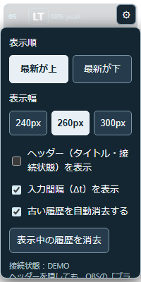

# PadLens

[English](README.md)

## PadLensの概要

PadLensは、[OBS Studio](https://obsproject.com/)と[Input Overlay](https://github.com/univrsal/input-overlay)を使い、ゲームパッドの現在の入力と直近の入力履歴を配信画面に表示します。2つの機能は別々に利用できます。OBS StudioやInput Overlayの公式製品ではありません。

## 表示例

**Controller Overlay** — 透過したコントローラーに現在の入力を表示します。

Saraテーマには、猫耳のLB/RB、長円形のLT/RT、肉球スティック、猫目風のView/Menu、鼻と口のHOMEがあります。Sara版のOBS実機表示は未確認です。

**Input History** — 直近の入力を縦に並べます。左は保存済み設定がない場合の表示、右は設定画面の操作例です。

 

画像を選ぶと元画像を開けます。いずれも模擬入力によるプレビューであり、実際の配信画面の撮影ではありません。

## 2つの機能

| 機能 | 表示内容 | OBSソース | WebSocket |
| --- | --- | --- | --- |
| [Controller Overlay](controller/README.ja.md) | ボタン、トリガー、スティックの現在の入力 | Input Overlay | 不要 |
| [Input History](history/README.ja.md) | 直近の入力、同時押し、連番、入力間隔 | ブラウザ | 必要 |

WebSocketはInput OverlayプラグインのWebSocketサーバーを指します。

## 動作確認済み環境・推奨設定

OBS Studio 33.0.0（ポータブル版）とInput Overlay 5.1.2の組み合わせで表示を確認しました。開発に使ったOSと、動作確認に使用した組み合わせは別の情報です。全操作や、ほかのOS・バージョンの動作を保証するものではありません。OBS StudioとInput Overlayは別途導入してください。

| 項目 | 内容 |
| --- | --- |
| 開発に使用したOS | Windows 10 / Windows 11 |
| 新規利用の推奨OS | Windows 11 |
| 動作確認に使用したOBS Studio | 33.0.0（ポータブル版） |
| 動作確認に使用したInput Overlay | 5.1.2 |
| History用ブラウザソースの推奨サイズ | 幅200px × 高さ400px |
| HistoryのWebSocket接続先 | `127.0.0.1:16899` |

[Windows 10の通常サポートは終了](https://support.microsoft.com/en-us/windows/deployment/updates-lifecycle/windows-10-support-has-ended-on-october-14-2025)しているため、新規利用者向けの推奨OSには含めません。

## 最短導入手順

詳しい手順は[日本語の導入手順](docs/installation.ja.md)を参照してください。最初はOBSのテスト用シーンで確認してください。

**Controllerを使う場合**

1. **Input Overlay**ソースを追加します。
2. 画像と設定ファイルに、`controller/`以下の次の組み合わせを指定します。

   | 表示 | PNG | JSON |
   | --- | --- | --- |
   | 標準版 | `controller_atlas.png` | `controller_layout.json` |
   | 高透過版 | `controller_atlas_light.png` | `controller_layout.json` |
   | Sara通常版 | `controller_atlas_sara.png` | `controller_layout_sara.json` |
   | Sara RTA版 | `controller_atlas_sara_rta.png` | `controller_layout_sara.json` |

3. Input Overlayソース側でゲームパッドを選びます。反応しない場合は、Input Overlayプラグインの設定でゲームパッドフックも確認してください。Controllerだけを使う場合、History用WebSocketの設定は不要です。

**Historyを使う場合**

1. OBSの「ツール」からInput Overlayプラグインの設定を開き、「WebSocket Server」でサーバーを有効にします。待受を`127.0.0.1:16899`に限定してください。設定の反映にはOBSの再起動が必要です。
2. GitHubのソースまたはPadLens配布ZIPをダウンロード・展開した後、`history/`のフォルダー構成を維持します。
3. OBSの**ブラウザ**ソースで**ローカルファイル**に`history/input_history.html`を指定し、幅200px・高さ400pxにします。
4. OBSの「対話（操作）」でHistoryの設定を開き、入力が履歴に表示されるか確認します。

入力が表示されない場合は、Input Overlayプラグインのゲームパッドフックと、Windowsがゲームパッドを認識しているかを確認してください。

## 表示されないとき

| 症状 | 最初に確認すること |
| --- | --- |
| Controllerが表示されない | Input Overlayソースに、対応するPNGとJSONの組を指定したか |
| ボタンに反応しない | Input Overlayプラグインのゲームパッドフックと、Input Overlayソースで選んだデバイス |
| Historyが接続されない | プラグイン設定のWebSocketサーバーが有効で、`127.0.0.1:16899`で待ち受けているか |
| Historyが空白になる | HTMLと3つのJavaScriptが同じフォルダにあるか |

詳しい確認方法は[導入手順](docs/installation.ja.md)を参照してください。

## セキュリティ

- WebSocketはループバックでのみ待ち受け、外部へポートを公開しないでください。
- ゲームパッド表示に不要なキーボード・マウスフックは無効にしてください。
- OBSの管理者権限での起動と、ブラウザのサンドボックス無効化は必要ありません。

詳しくは[SECURITY.md](SECURITY.md)を参照してください。

## ライセンス

PadLens独自のコード、テスト、文書、Controller PNG画像とHOME図形には[MIT License](LICENSE)を適用します。著作権表示は`Copyright (c) 2026 saraefcat`です。OBS StudioとInput Overlayは別プロジェクトです。
