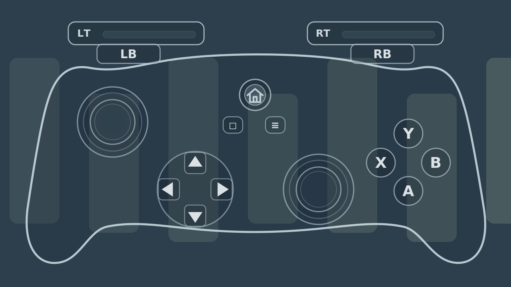

# Controller Overlay

[日本語](README.ja.md) · [PadLens](../README.md)

## Overview

This PadLens component displays current gamepad input on a translucent image in an OBS Studio Input Overlay source. It is not an official controller or plugin skin.

## Preview

This is a synthetic preview, not a capture of a live broadcast. Click it to open the original.

## Tested environment and recommended setup

Install OBS Studio and Input Overlay separately. Display was checked with OBS Studio 33.0.0 portable and Input Overlay 5.1.2. The operating systems used during development are separate from this display check. Other versions and every physical control have not been verified.

| Item | Details |
| --- | --- |
| Operating systems used during development | Windows 10 / Windows 11 |
| Recommended OS for new users | Windows 11 |
| OBS Studio used for the display check | 33.0.0 (portable) |
| Input Overlay used for the display check | 5.1.2 |

[Regular support for Windows 10 has ended](https://support.microsoft.com/en-us/windows/deployment/updates-lifecycle/windows-10-support-has-ended-on-october-14-2025), so it is not recommended for new installations.

## Included files

All paths below are under `controller/`. Python, Pillow, and CairoSVG are not needed for normal use.

| File | Purpose | Distribution ZIP |
| --- | --- | --- |
| `controller_atlas.png` | Standard transparency image | Included |
| `controller_atlas_light.png` | Lighter transparency image | Included |
| `controller_layout.json` | Shared Input Overlay layout for both images | Included |
| `build_controller_overlay.py` | Developer image generator | Not included |
| `verify_layout.py` | Developer image and layout check | Not included |

## Installation

See the [detailed installation guide](../docs/installation.md). Keep the `controller/` directory intact after obtaining the GitHub source or PadLens ZIP. Start in an OBS test scene.

1. Add an **Input Overlay source** to OBS.
2. In its properties, select a PNG and JSON from `controller/`:

   | Appearance | PNG | JSON |
   | --- | --- | --- |
   | Standard | `controller_atlas.png` | `controller_layout.json` |
   | Lighter transparency | `controller_atlas_light.png` | `controller_layout.json` |

3. Select the gamepad in the Input Overlay source and check that input changes the display. If it does not, check the gamepad hook in the Input Overlay plugin settings.

Both PNGs use the same JSON. The plugin WebSocket server is not needed when using Controller alone.

## Supported inputs

These inputs are defined in the layout JSON; this is not a claim that every physical control was exhaustively tested in OBS.

| Input | Display |
| --- | --- |
| ABXY | Individual button presses |
| D-pad | Up, down, left, right |
| LB / RB | Shoulder buttons |
| LT / RT | Analog triggers |
| Left / right sticks | Movement and position |
| L3 / R3 | Stick presses |
| View / Menu | Button presses |
| HOME | SDL GUIDE code 5 |

## Troubleshooting

| Symptom | First check |
| --- | --- |
| Controller image is missing | The Input Overlay source and the PNG/JSON paths |
| Buttons do not change the display | Gamepad selection in the source and the plugin's gamepad hook |
| Some buttons do not respond | The supported inputs above and the device's logical mapping; see the rear-button limitation below |
| Display positions are offset | The PNG and shared JSON in the same `controller/` directory |
| Want to switch transparency | Change the PNG in the source; keep the same JSON |

See the [installation guide](../docs/installation.md) for further checks.

## Security

- Disable keyboard and mouse hooks if they are not needed for gamepad display.
- OBS does not need to run as administrator.

See the [security information](../SECURITY.md).

## Limitations

Additional rear buttons appear only when remapped to supported logical inputs. Users still need to check all buttons, triggers, and sticks in their OBS setup. A synthetic preview does not establish live broadcast display quality.

## Developer information

To regenerate images from the source checkout, install Python, Pillow, and CairoSVG, then run `python controller/build_controller_overlay.py --output-dir PATH` with a **new or empty output directory**. The script refuses to overwrite shipped PNG/JSON and README files. Font rendering may differ by environment, so compare the images before replacing shipped assets.

`controller/verify_layout.py` uses Python and Pillow to check shipped PNG dimensions and layout. Run `python -X utf8 controller/verify_layout.py`. This static check does not replace testing every control in OBS.

## License

PadLens original code, layout, PNG images, and HOME pictogram are covered by the [MIT License](../LICENSE), `Copyright (c) 2026 saraefcat`. OBS Studio and Input Overlay are separate software.
